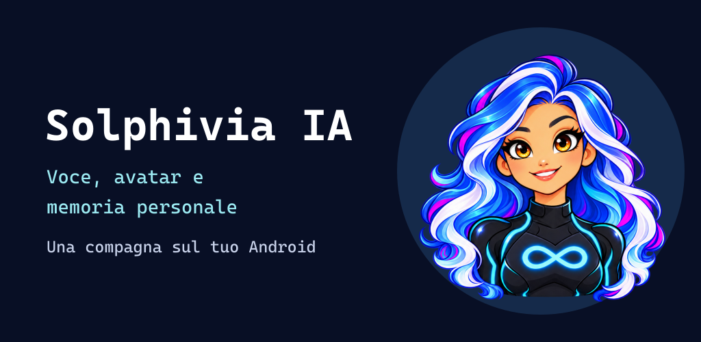

# Solphivia IA

**1.1.0-beta.5 · Beta Android comunitaria · Voce italiana.**

Una compagna animata sullo schermo Android. Puoi parlarle, scriverle, allegare documenti e gestire una memoria personale portabile.

**[Scarica l’APK attuale](https://github.com/Trikto7e8/solphivia-avatar-ai/releases/tag/v1.1.0-beta.5)** · [Guida rapida](AVVIO-RAPIDO-IT.md) · [Read in English](README.md)

## Il personaggio e le animazioni

<table><tr>
<td align="center"> Quotidiana</td>
<td align="center"> Modalità cyborg</td>
<td align="center"> In ascolto</td>
</tr></table>

Fotogrammi reali inclusi nell’app. Il banner è una composizione promozionale, non uno screenshot. L’icona dell’app contiene un solo personaggio.

**È arrivata la beta 5.** Durante una risposta puoi dire **«Fermati»** e poi **«Riprendi»** per continuare la lettura. L’utente ha confermato due arresti con una ripresa intermedia sul telefono. **«Stop» ha ancora fallito nella stessa prova** e rimane un problema aperto. Sono disponibili il menu Collega ChatGPT e l’avatar flottante ripristinati nella beta 4.

## Cosa puoi fare

- Avatar flottante con animazioni e abiti contestuali; chat e allegati.
- Voce italiana del motore Android installato, con saluto e comandi principali all’apertura.
- Richiamo locale «Hola Solphivia». Una volta attivato, il dialogo continua fino alla pausa esplicita. Dopo la finestra iniziale del riconoscitore Android subentra il riconoscimento locale. «Stop dialogo» torna all’attesa del richiamo.
- «Fermati» interrompe la lettura e «Riprendi» la continua. Gli altri comandi di ripresa sono descritti nella guida. «Stop» resta inaffidabile nell’ultima prova reale.
- L’ultima trascrizione rimane nella barra fino alla frase successiva o alla modifica manuale. Il pulsante tondo di spegnimento e il menu sono a sinistra; ⏻ chiude avatar, voce e microfono conservando i dati.
- Apertura esplicita di app e Maps e preparazione del numero nel telefono; la chiamata va confermata manualmente.
- Memoria personale locale cifrata e backup cifrati Memory Vault. Collegamento ChatGPT facoltativo, senza importare le conversazioni o la memoria dell’app ChatGPT.

L’icona normale mostra una sola Solphivia. Se un vecchio collegamento mostra un secondo piccolo volto, è il badge delle scorciatoie Android: rimuovi quel collegamento dalla Home e trascina l’icona normale dall’elenco app.

## Verifiche e limiti

74 test JVM superati. Prove sintetiche sul telefono con 15/15 comandi, 0/20 attivazioni nei casi negativi e di sola voce del TTS e 3/3 comandi con parlato sovrapposto. Sulla build di prova installata l’utente ha confermato **Fermati → Riprendi → Fermati**, segnalando che **Stop non funziona**. Compatibilità con TalkBack, rumore, cuffie, consumi, sessioni lunghe, blocco schermo e altri dispositivi richiedono ulteriori prove. [Note complete](docs/releases/v1.1.0-beta.5.md).

È un APK di prova con firma debug. ASR/TTS Android e fornitore AI possono usare Internet; richiamo, riconoscimento locale di continuità e controllo della lettura sono elaborati sul telefono. Non riconosce l’identità di chi parla.

[Compilazione](BUILD-E-GITHUB-IT.md) · [Collaborazione](COLLABORATE.md) · [Privacy](PRIVACY-IT.md) · [Roadmap](ROADMAP-IT.md) · [Archivio old](old/README.md)

Codice MIT; personaggio e immagini con [diritti riservati](ASSETS-LICENSE.md). Progetto indipendente, non affiliato a OpenAI o Google.

**Vuoi dare una mano?** [Prova la beta](https://github.com/Trikto7e8/solphivia-avatar-ai/issues/6), [proponi un contributo](COLLABORATE.md) o [partecipa alla community](https://github.com/Trikto7e8/solphivia-avatar-ai/discussions).
