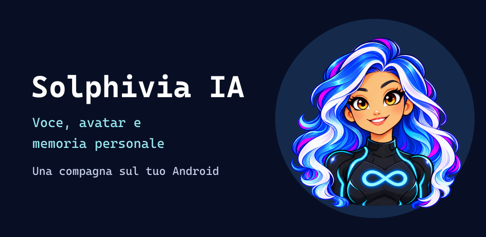

# Solphivia IA

**1.1.0-beta.3 · Beta Android comunitaria · Voce italiana.**

Una compagna animata sullo schermo Android. Puoi parlarle, scriverle, allegare documenti e gestire una memoria personale portabile.

**[Scarica l’APK attuale](https://github.com/Trikto7e8/solphivia-avatar-ai/releases/tag/v1.1.0-beta.3)** · [Guida rapida](AVVIO-RAPIDO-IT.md) · [Read in English](README.md)

## Il personaggio e le animazioni

<table><tr>
<td align="center"> Quotidiana</td>
<td align="center"> Modalità cyborg</td>
<td align="center"> In ascolto</td>
</tr></table>

Fotogrammi reali inclusi nell’app. Il banner è una composizione promozionale, non uno screenshot. L’icona dell’app contiene un solo personaggio.

## Cosa puoi fare

- Avatar flottante con animazioni e abiti contestuali; chat e allegati.
- Voce italiana del motore Android installato, con saluto e comandi principali all’apertura.
- Richiamo locale «Hola Solphivia». Dopo ogni risposta hai cinque secondi per iniziare il comando successivo; in silenzio resta l’attesa del richiamo.
- «Stop» e «Alt» interrompono la lettura. «Riprendi», «Prosegui», «Continua», «Dimmi», «Ti ascolto», «Dai» e «Vai» riprendono una lettura sospesa.
- Trascrizione visibile nella barra durante la risposta. Il pulsante tondo di spegnimento e il menu sono a sinistra; ⏻ chiude avatar, voce e microfono conservando i dati.
- Apertura esplicita di app e Maps e preparazione del numero nel telefono; la chiamata va confermata manualmente.
- Memoria personale locale cifrata e backup cifrati Memory Vault. Collegamento ChatGPT facoltativo, senza importare le conversazioni o la memoria dell’app ChatGPT.

L’icona normale mostra una sola Solphivia. Se un vecchio collegamento mostra un secondo piccolo volto, è il badge delle scorciatoie Android: rimuovi quel collegamento dalla Home e trascina l’icona normale dall’elenco app.

## Verifiche e limiti

65 test JVM superati sui sorgenti finali; prove sintetiche sul telefono: 13/13 frasi positive e 0/15 attivazioni nei casi negativi. Il manutentore ha confermato arresto, ripresa, comando successivo al saluto, trascrizione e spegnimento. Per la beta 3 sono verificati build/Lint, icona Home e pulsanti a sinistra. Rumore, cuffie, consumi, sessioni lunghe, blocco schermo e altri dispositivi richiedono ulteriori prove. [Note complete](docs/releases/v1.1.0-beta.3.md).

È un APK di prova con firma debug, non una release gli store. ASR/TTS Android e fornitore AI possono usare Internet; richiamo e controllo della lettura sono locali. Non riconosce l’identità di chi parla.

[Compilazione](BUILD-E-GITHUB-IT.md) · [Collaborazione](COLLABORATE.md) · [Privacy](PRIVACY-IT.md) · [Roadmap](ROADMAP-IT.md) · [Archivio old](old/README.md)

Codice MIT; personaggio e immagini con [diritti riservati](ASSETS-LICENSE.md). Progetto indipendente, non affiliato a OpenAI o Google.

**Vuoi dare una mano?** [Prova la beta](https://github.com/Trikto7e8/solphivia-avatar-ai/issues/6), [proponi un contributo](COLLABORATE.md) o [partecipa alla community](https://github.com/Trikto7e8/solphivia-avatar-ai/discussions).
