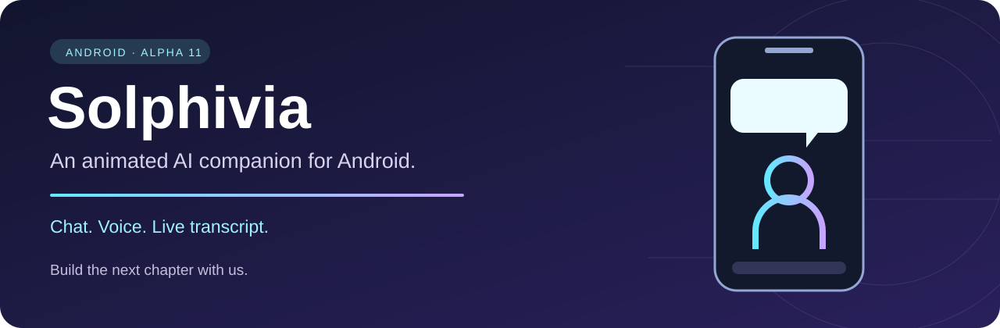

# Meet Solphivia

**New in alpha9 — hands-free commands.** Say “Hola Solphivia”, wait for the spoken reply, then ask a question or open WhatsApp. Local wake listening; Android command recognition may use the network. Voice requests no longer stop at the memory confirmation screen. [What is tested, setup and limits](docs/releases/v0.9.2-alpha9.md).

An animated companion on your Android screen. Talk, type, attach a file, and keep your assistant's personal memory under your control.

**[Try the Android alpha](https://github.com/Trikto7e8/solphivia-avatar-ai/releases/tag/v0.9.2-alpha9)** · **[Help build Solphivia](COLLABORATE.md)** · [Leggi in italiano](README-IT.md)

> Community alpha · Android available for testing · Google Play and iOS are work ahead.

## A character that moves with the conversation

<table><tr>
<td align="center"> <b>Everyday companion</b></td>
<td align="center"> <b>Cyborg mode</b></td>
<td align="center"> <b>Ready to listen</b></td>
</tr></table>

Actual character frames from the Android app. Artwork is reserved under [ASSETS-LICENSE.md](ASSETS-LICENSE.md).

| Make it yours | Keep control | Build together |
| --- | --- | --- |
| Draggable avatar, animations, chat and Android speech. | Local encrypted memory, editable sharing previews and encrypted Memory Vault export. | Help improve Android, accessibility and testing; design local-model adapters and iOS. |

## Start in a few minutes

1. Get the APK from the [alpha release](https://github.com/Trikto7e8/solphivia-avatar-ai/releases/tag/v0.9.2-alpha9). This is a debug test build, not a store release.
2. Follow the [Italian setup guide](AVVIO-RAPIDO-IT.md), enable the overlay and choose an installed Android speech engine.
3. Try the avatar and share a [reproducible test report](https://github.com/Trikto7e8/solphivia-avatar-ai/issues/6) using synthetic examples.

**Want to contribute?** Start with [testing](https://github.com/Trikto7e8/solphivia-avatar-ai/issues/6), [Android release readiness](https://github.com/Trikto7e8/solphivia-avatar-ai/issues/3), [iOS feasibility](https://github.com/Trikto7e8/solphivia-avatar-ai/issues/4) or [model providers](https://github.com/Trikto7e8/solphivia-avatar-ai/issues/5). Small, focused contributions are welcome.

**Explore:** [Collaboration](COLLABORATE.md) · [Privacy](PRIVACY-IT.md) · [Contributing](CONTRIBUTING.md) · [AI Memory Vault](https://github.com/Trikto7e8/AI-memory-vault)

## What it does today

- Shows Solphivia as a draggable Android overlay with a speech bubble and one-line chat input.
- Includes idle, run, bounce, sit, sleep, and cyborg animation states.
- Supports speech output, Android speech recognition, and document/image attachments.
- Connects to ChatGPT through OpenAI's Sign in with ChatGPT flow and eligible Responses API usage. It does not read the user's ChatGPT conversations or memory.
- Stores the local conversation on the device and encrypts OAuth credentials with Android Keystore.

The ChatGPT connection is optional and depends on account eligibility and user consent. ChatGPT plan usage is distinct from OpenAI API-key billing. See [OpenAI's documentation](https://developers.openai.com/siwc/token-sharing-open-source) and [privacy details](https://help.openai.com/en/articles/20001542-using-your-chatgpt-plan-in-other-apps-and-sites).

## Project direction

The goal is to keep Solphivia's avatar and interaction layer independent from any one model provider. Planned work includes:

1. A small provider interface for chat and model capabilities.
2. Local connections to a model server such as LM Studio or Ollama.
3. Additional cloud provider adapters, configured with each user's own account or credentials.
4. A later on-device model option, subject to phone memory, performance, and model licenses.
5. Better multilingual voice, wake accuracy and battery measurements across devices.

These are roadmap items, not current features. Each provider will need its own adapter; compatibility with every LLM cannot be promised.

## Build the current prototype

- Android Studio with Android SDK 35 and JDK 17
- Gradle 8.11.1 / Android Gradle Plugin 8.9.1

Open this folder in Android Studio and build `:app:assembleDebug`. The debug APK is created at `app/build/outputs/apk/debug/app-debug.apk`.

The project currently targets API 35. A Play Store submission needs migration and testing against the current Play target API requirements before it can be submitted.

## Google Play preparation

Before a Play release, the project needs (at minimum):

- Target API 36 and a signed Android App Bundle.
- A privacy policy and an accurate Play Data safety declaration for account data, chat text, attachments, and speech features.
- An in-app way to report or flag problematic AI responses.
- Play Console declarations and review for the overlay and `specialUse` foreground services.
- Device testing, store assets, content rating, and a closed test if the developer account is subject to that requirement.

## Privacy and affiliation

When connected to an AI provider, prompts and selected attachments are sent to that provider to answer the request. Review each provider's terms and configure its connection deliberately. Solphivia is an independent project and is not sponsored by or affiliated with OpenAI. OpenAI, ChatGPT, and related names are trademarks of their respective owner; they are used only to identify an optional integration.

For the current Android prototype's local storage, voice, attachment, and overlay behavior, see [PRIVACY-IT.md](PRIVACY-IT.md). It is a technical draft, not a substitute for the complete public privacy policy required for a store release.

## Licenses

- Source code: MIT, see `LICENSE`.
- Solphivia character, face, animation sprites, costume designs, launcher artwork, and visual identity: reserved; see `ASSETS-LICENSE.md` or [the Italian translation](LICENZA-ASSET-IT.md).

## Contributing

Code contributions are welcome. Please read `CONTRIBUTING.md` first. Do not post credentials, access tokens, private user content, or private screenshots in issues or pull requests. Contributions to code do not grant rights to reuse the Solphivia character or artwork.

## Current verification status

Version **0.9.2-alpha9** (code 38) passed build, Android Lint and isolated command/consent checks. The device user confirmed wake, WhatsApp opening and automatic voice submission on 22 October 2026. Screen-lock behavior, long battery sessions and other devices still need testing. [Release notes](docs/releases/v0.9.2-alpha9.md).

## New in alpha4

- One avatar at a time: the floating window hides while the internal chat is visible and returns when you leave.
- Keeps the voice selected in the Android speech engine instead of choosing another equivalent variant.
- Contextual Prof, VJ, Codex and Meteorina modes, with manual outfit priority and a 20-second interval between automatic changes.
- Three brief gestures: nod, explain and celebrate, animated from existing sprites; reduced-motion option in the preview.
- Existing sitting and sleep states preserved; thinking remains active while a response is pending.

Use `scegli tu` or `modalità auto` to enable contextual outfit choice. Explicit `prof`, `vj`, `codex` or `meteorina` commands pin the outfit. Contextual suggestions come from the conversation, not observation of other apps. See [the behavior notes](docs/CONTEXTUAL-AVATAR-DECISIONS.md).

## 0.9.2-alpha2

- Memoria personale cifrata sul dispositivo, editor e comando `ricorda:`; import/export cifrato compatibile con AI Memory Vault v1. Anteprima modificabile per ogni invio remoto. Nessuna sincronizzazione automatica e nessun nuovo adattatore LLM.
- Pulsanti `+` e microfono visibili anche nella schermata interna; dettatura modificabile prima dell’invio e allegati mantenuti nei turni successivi.
- Scelta del motore TTS e accento inglese con voce offline, quando disponibile. eSpeak NG è separato e non incluso nell’APK.
- Radar DPC aggiornato: dati, timestamp ed errori visibili. Segnala echi vicini, senza stimare direzione o tempo di arrivo.
- Sonno animato, proporzioni corrette e schermata `☰ → Prova animazioni`; 108 sprite e 1248 combinazioni verificate.

Scarica l’APK dalla [pre-release v0.9.2-alpha2](https://github.com/Trikto7e8/solphivia-avatar-ai/releases/tag/v0.9.2-alpha9). È una build debug per test, non una distribuzione Google Play. Il profilo iniziale è generico e può essere personalizzato localmente nell’editor Memoria.
