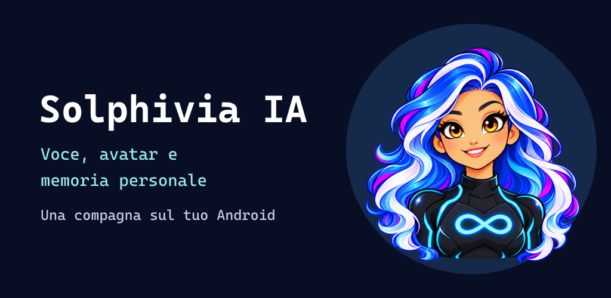

# Solphivia IA 1.1 beta 5

7 novembre 2026 · `v1.1.0-beta.5` · codice 53 · `it.solphivia.mobile`.

[Scarica APK e sorgenti](https://github.com/Trikto7e8/solphivia-avatar-ai/releases/tag/v1.1.0-beta.5) · [Guida italiana](../../AVVIO-RAPIDO-IT.md) · [Collabora](../../COLLABORATE.md).

## Conversazione e lettura

- Il dialogo già attivato prosegue con il riconoscimento locale dopo la finestra iniziale Android e in caso di errori temporanei del riconoscitore.
- L’ultima trascrizione rimane nella barra fino alla frase successiva o alla modifica manuale. Le bozze manuali restano protette.
- Il controllo di interruzione tiene conto dell’eco del testo letto e dei risultati parziali stabili. Le anteprime identiche evitano aggiornamenti ripetuti del campo.
- Le interruzioni temporanee della cattura locale attivano un tentativo di ripristino. I permessi mancanti richiedono l’intervento dell’utente.

## Prova reale e problema noto

L’utente ha provato la build codice 52, `1.1.0-beta.5-test.2`, confermando **Fermati → Riprendi → Fermati**. **Stop non è stato riconosciuto nella stessa prova**. Per interrompere la lettura usare **Fermati**. Alt e Basta richiedono ulteriori prove reali.

La beta pubblica codice 53 usa lo stesso codice applicativo della prova 52, con metadati di versione aggiornati. Il collaudo con la voce dell’utente riguarda quella build di prova. Compilazione e controlli della build pubblica sono verificati separatamente.

## Prove automatiche e sintetiche

- 74 test JVM superati.
- APK principale e test Android compilati, Lint senza errori.
- Su telefono, nella copia isolata, 15/15 comandi sintetici, 0/20 attivazioni nei casi negativi e di sola voce TTS, 3/3 comandi con parlato sintetico sovrapposto.
- Il mix sintetico usa sfondo al 18% e comando all’80%. Non simula la cancellazione acustica del microfono. Le registrazioni sintetiche temporanee sono eliminate dopo il test.
- Nella lavorazione sono passate anche le prove del campo di trascrizione, comprese le modifiche manuali e i risultati di catture precedenti.

TalkBack, rumore, cuffie, batteria, sessioni lunghe, blocco schermo e più dispositivi restano da collaudare. I risultati sintetici sono distinti dai riscontri reali.

## Aggiornare

APK beta firmato debug, Android 8+, ARM64/ARMv7. Installare sopra la beta esistente con lo stesso certificato per mantenere i dati. Verificare APK e archivio sorgenti con `SHA256SUMS.txt` allegato alla release.

## Contribuire

Cerchiamo prove riproducibili su altri dispositivi, miglioramenti di accessibilità e contributi mirati alla voce. Usare testo e file sintetici nei report pubblici.

[Segnala la tua prova](https://github.com/Trikto7e8/solphivia-avatar-ai/issues/6) · [Affidabilità Android](https://github.com/Trikto7e8/solphivia-avatar-ai/issues/3) · [Community](https://github.com/Trikto7e8/solphivia-avatar-ai/discussions).

## English

Active dialogue now has local recognition continuity and persistent transcripts. The device user confirmed **Fermati → Riprendi → Fermati**. **Stop failed in that live trial** and remains a known issue. Use Fermati to interrupt reading. TalkBack coexistence and wider device testing are still pending.
